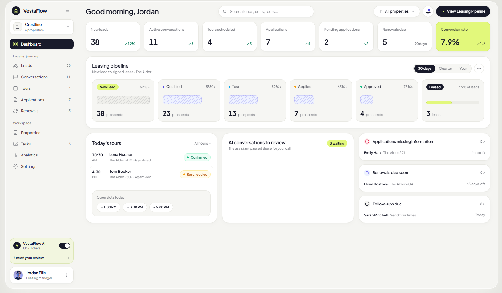

# VestaFlow Building

Template dashboard responsif untuk operasional penyewaan properti. Gunakan untuk menampilkan metrik, menelusuri pipeline leasing, dan mencoba pengelolaan prospek, tur, aplikasi, perpanjangan sewa, serta tugas.

**[Buka demo publik ↗](https://laluarifta.github.io/vestaflow_building/)**



## Jalankan secara lokal

Butuh Node.js 24, npm, dan Python 3 untuk menjalankan contoh server lokal.

```sh
npm ci
npm run build
python -m http.server 8000 --directory frontend
```

Buka <http://localhost:8000/>. Saat mengubah gaya, jalankan `npm run dev` di terminal terpisah agar CSS otomatis dikompilasi ulang.

## Struktur proyek

```text
frontend/
├── index.html              # Kerangka dashboard dan dialog
└── assets/
    ├── css/dashboard.css   # Hasil kompilasi (tidak masuk Git)
    └── js/
        ├── dashboard.js    # State, interaksi, formulir, dan metrik
        ├── demo-data.js    # Data awal demo
        └── views.js        # Tampilan dashboard dan halaman lain
src/styles/dashboard.css    # Gaya kustom dan input Tailwind
tailwind.config.cjs         # Palet, tipografi, dan pengaturan Tailwind
docs/images/               # Gambar preview README
.github/workflows/pages.yml # Build dan deployment GitHub Pages
```

## Kustomisasi dan deploy

- Ubah data contoh di `frontend/assets/js/demo-data.js` dan tampilan di `frontend/assets/js/views.js`.
- Ubah palet dan jenis huruf di `tailwind.config.cjs`, serta gaya khusus di `src/styles/dashboard.css`.
- Untuk menerbitkan salinan, pilih **Settings → Pages → Source → GitHub Actions**. Workflow `pages.yml` membangun dan menerbitkan `frontend/` saat ada push ke `main`, atau saat dijalankan manual dari tab **Actions**.

Demo berjalan tanpa login atau backend. Data awal bersifat contoh; perubahan disimpan di browser saja dan bisa dihapus lewat **Settings → Reset Data**. Antrean AI hanya simulasi. Font dan foto menggunakan aset eksternal dari Google Fonts dan Unsplash.
